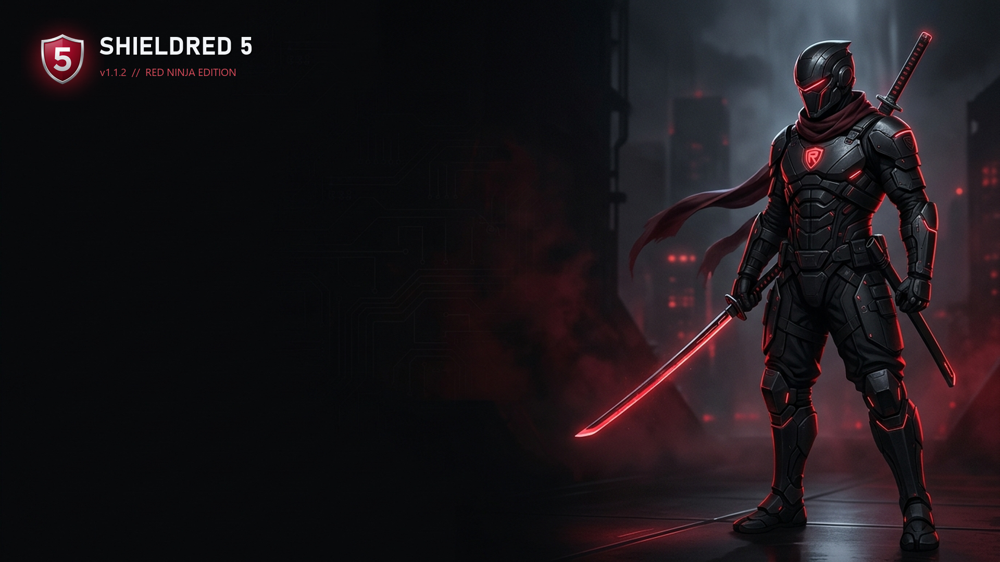

<div align="center">



# `0xShieldRed 5` — `v1.1.2 // RED NINJA EDITION`

**Zero-Telemetry, Air-Gap-Safe Multi-Boot USB Arsenal for Red Team Operators, Security Researchers & Systems Engineers**

`ZERO DATA TRACKING` · `100% OFFLINE WEB UI` · `LINUX · MACOS · WINDOWS · NPM` · `GPL-3.0`

</div>

---

```text
┌──────────────────────────────────────────────────────────────────────────────┐
│  root@red-ops:~# shieldred5 --opsec-profile                                  │
│  > telemetry        : DISABLED (0 outbound calls / 0 analytics / 0 updates)  │
│  > plugson_ui       : OFFLINE  (127.0.0.1 bind; external CDNs/fonts stripped)│
│  > metadata_hygiene : HARDENED (Adobe XMP & PDB debug paths scrubbed)        │
│  > disk_safety      : ARMED    (preflight checks; macOS disk0/internal lock) │
└──────────────────────────────────────────────────────────────────────────────┘
```

> [!IMPORTANT]
> **Built for Red Hacker & Security Lab Workflows:** Keep your offensive, forensic, rescue, and Linux/Windows ISO payloads on one multi-boot USB without vendor telemetry, external web requests, or accidental data loss during bootloader upgrades.

---

## `0x01` // Zero Data Tracking & OPSEC Hardening

* **No Telemetry, No Phone-Home**: The CLI wrappers, Python block/FAT16 helpers (`tool/shieldred5_helper.py`, `tool/shieldred5_macos.py`), shell installers, and packaged binaries make **zero outbound network requests** during USB creation, inspection, or updates.
* **Air-Gapped Plugson Configurator**: Every `.html` page inside `shieldred5/plugson.tar.xz` has been audited and stripped of external CDN links, remote Google/web fonts, and Flash references—serving strictly local assets over `127.0.0.1`.
* **Scrubbed Release Artifacts**: Built with Adobe XMP metadata and PDB debug paths removed (`README.txt`), while runtime logs stay strictly local (`./log.txt` in portable mode or `~/.local/state/shieldred5/log.txt` for system installs) and are ignored by `.gitignore` and `.npmignore`.
* **Tactical Boot Controls**:
  * `-s` / `-S` — Toggle UEFI Secure Boot shim (`VTOYEFI` / direct GRUB2 EFI) on demand.
  * `-r N` — Reserve `N` MiB of raw trailing disk space for encrypted containers or secondary partitions.
  * `-u` — Non-destructive bootloader/EFI upgrade preserving Partition 1 ISOs and payloads.
  * Password & Menu Hardening — Built-in Plugson support for boot/ISO/WIM/IMG/VHD/EFI passwords, whitelists/blacklists, and config replacement.

---

## `0x02` // Rapid Deployment via `npm` (`Windows / Linux / macOS`)

Requires **Node.js >= 18**.

```bash
# Install globally directly from GitHub
npm install -g git+https://github.com/neithdo269/0xShieldRed-5.git

# Or clone & install locally
git clone https://github.com/neithdo269/0xShieldRed-5.git
cd 0xShieldRed-5
npm install -g .
```

Operator commands:

```bash
shieldred5 --help                  # Cross-platform CLI reference
shieldred5 --doctor                # Audit host tools, payloads & Linux dependencies
shieldred5 --distro-cmd all        # Print dependency commands for all Linux distros
sudo shieldred5 --install-deps     # Auto-install missing Linux distro packages
sudo shieldred5 -i /dev/sdX        # Provision USB drive on Linux
sudo shieldred5 -i /dev/diskN      # Provision USB drive on macOS
shieldred5                         # Launch Windows GUI (x64 or Win32)
shieldred5 --plugson [USB_DIR]     # Start offline localhost Plugson UI (127.0.0.1:24680)
shieldred5-plugson [USB_DIR]       # Direct Plugson Web UI launcher
```

---

## `0x03` // Linux Multi-Distro Arsenal

### Portable & System-Wide Install

```bash
# Inspect distro & verify required tools before touching any disk
bash ./ShieldRed5_Linux.sh --doctor

# Auto-install dependencies via your distro's package manager
sudo bash ./ShieldRed5_Linux.sh --install-deps

# System-wide install (/usr/local/bin/shieldred5 & /usr/local/bin/shieldred5-plugson)
sudo bash ./install.sh --install-deps

# Clean removal
sudo bash ./uninstall.sh
```

### Supported Linux Distributions

| Target Distro Family | Pkg Mgr | One-Line Dependency Setup |
|---|---|---|
| **Kali / Parrot / Debian / Ubuntu / Mint / Pop!_OS / RPi OS** | `apt-get` | `sudo apt-get update && sudo apt-get install -y bash parted dosfstools exfatprogs xz-utils python3 util-linux` |
| **Fedora / RHEL / CentOS Stream / Rocky / AlmaLinux** | `dnf` | `sudo dnf install -y bash parted dosfstools exfatprogs xz python3 util-linux` |
| **Arch Linux / BlackArch / Manjaro / EndeavourOS / SteamOS** | `pacman` | `sudo pacman -Sy --needed --noconfirm bash parted dosfstools exfatprogs xz python util-linux` |
| **openSUSE Leap / Tumbleweed / SLES** | `zypper` | `sudo zypper --non-interactive install bash parted dosfstools exfatprogs xz python3 util-linux` |
| **Alpine Linux / postmarketOS** *(BusyBox `dd` supported)* | `apk` | `sudo apk add --no-cache bash parted dosfstools exfatprogs xz python3 util-linux coreutils` |
| **Void Linux** | `xbps-install` | `sudo xbps-install -Sy bash parted dosfstools exfatprogs xz python3 util-linux` |
| **Gentoo / Pentoo / Calculate** | `emerge` | `sudo emerge --ask=n app-shells/bash sys-block/parted sys-fs/dosfstools sys-fs/exfatprogs app-arch/xz-utils dev-lang/python sys-apps/util-linux` |
| **Solus** | `eopkg` | `sudo eopkg install -y bash parted dosfstools exfatprogs xz python3 util-linux` |
| **Clear Linux** | `swupd` | `sudo swupd bundle-add sysadmin-basic python3-basic storage-utils` |
| **Fedora Silverblue / Kinoite / Bazzite** | `rpm-ostree` | `rpm-ostree install parted dosfstools exfatprogs python3` |
| **NixOS / Nix** | `nix` | `nix-shell -p bash parted dosfstools exfatprogs xz python3 util-linux` |

> [!NOTE]
> On older Debian/Ubuntu systems lacking `exfatprogs`, use `exfat-utils` (`--install-deps` falls back automatically). On RHEL/Rocky/Alma 8 or 9, enable `epel-release` if `exfatprogs` is not in base repos.

### Native Distro Packaging Recipes (`packaging/`)

| Target | Recipe | Build / Usage |
|---|---|---|
| **Debian / Ubuntu / Kali (`.deb`)** | `packaging/debian/control` | `bash ./packaging/debian/build-deb.sh` |
| **Fedora / RHEL / openSUSE (`.rpm`)** | `packaging/rpm/shieldred5.spec` | `rpmbuild -ba packaging/rpm/shieldred5.spec` |
| **Arch Linux (`PKGBUILD`)** | `packaging/arch/PKGBUILD` | `cd packaging/arch && makepkg -si` |
| **Alpine Linux (`APKBUILD`)** | `packaging/alpine/APKBUILD` | `abuild -r` |
| **Void Linux (`xbps-src`)** | `packaging/void/template` | `xbps-src pkg shieldred5` |
| **Gentoo (`ebuild`)** | `packaging/gentoo/shieldred5-1.1.2.ebuild` | Local overlay `emerge` |
| **NixOS / Nix Flakes** | `packaging/nix/flake.nix` | `nix run ./packaging/nix` / `nix develop ./packaging/nix` |

---

## `0x04` // macOS Targeting

Uses built-in `diskutil`, `newfs_exfat`, `newfs_msdos`, `python3`, and 4K-aligned raw `/dev/rdiskN` block I/O.

```bash
sudo bash ./ShieldRed5_macOS.sh -i /dev/diskN
# Or globally after install.sh / npm install -g:
sudo shieldred5 -i /dev/diskN
```

> [!CAUTION]
> Always verify `/dev/diskN` with `diskutil list` before flashing. `disk0` and internal macOS drives are blocked by default (`--allow-internal` required to override).

* **Intel Macs**: Pass `-S` to disable the Secure Boot shim when booting Intel Macs directly.
* **Apple Silicon (`M1`–`M4`)**: Cannot boot PC/UEFI USB media natively (uses iBoot), but can safely prepare bootable USB drives for PCs and Intel Macs (plus `--image` testing on raw `.img` files).

---

## `0x05` // Windows Native Binaries

* `ShieldRed5.exe` / `altexe\ShieldRed5_X64.exe` — USB installer / updater GUI & CLI (Win32 / x64)
* `ShieldRed5Plugson.exe` / `altexe\ShieldRed5Plugson_X64.exe` — Native offline Plugson web UI (Win32 / x64)
* `ShieldRed5Vlnk.exe` — Virtual link (`.vlnk`) creator GUI & CLI (Win32)

---

## `0x06` // Verification & License

```bash
npm test         # CLI, distro detection, Plugson HTTP/RPC & LF checks
npm run doctor   # Host tool & payload integrity verification
npm run pack:check
```

Licensed under the **GNU General Public License v3.0** (`GPL-3.0-only`).
